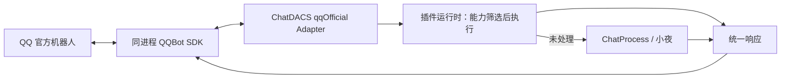

# 官方 QQ 通道接入设计

> 本文保留设计时的 Node 版本与验证记录；现行运行基线以主仓 [`.nvmrc`](../../.nvmrc) 和 [UPGRADE.md](../../UPGRADE.md) 为准，历史结果不自动成为新版本验收。

状态：单进程方案已实现，正在本地验收；真实机器人绑定与收发待人工验收。2026-10-27 核验官方源代码与 npm 元数据。

## 已确认的产品目标

官方 QQ 通道接入 ChatDACS，继续使用小夜人格、兼容的旧插件和现有聊天核心。
用户已确认此方向；不引入 DSH Agent 接管应答。
现有 NapCat / OneBot、QQ Guild 和 Web 通道继续独立工作。

## 官方能力与接入选型

`@tencent-connect/dsh-qqbot@latest` 当前解析为 0.5.3，是 Cordis / DeepSeek Harness 插件，
通过 `ctx.agents`、会话事件和 DSH Agent 执行聊天；它不提供 OneBot 11 接口。
直接加载它会让 ChatDACS 依赖另一套 Agent、会话和插件宿主。

推荐复用该插件实际使用的两个官方组件：

| 组件 | 核验版本 | 职责 | 运行要求 |
| --- | --- | --- | --- |
| `@tencent-connect/qqbot-connector` | 1.2.0 | 扫码获取机器人 AppID / AppSecret | Node >=18，CJS / ESM |
| `@tencent-connect/qqbot-nodejs` | 1.0.5 | 鉴权、WebSocket、收发消息、媒体、重连 | Node >=20，ESM |
| `@tencent-connect/dsh-qqbot` | 0.5.3 | DSH 宿主集成参考 | Node >=20.3，依赖 DSH 服务 |

实施时固定验证过的依赖版本并提交独立 lockfile；`latest` 只用于发现版本。
SDK 的接口与平台实际授权是不同边界，需用测试机器人验证账号可用能力。

## 已确认的运行结构

用户选择先升级主项目 Node，再单进程接入。`package.json`、CI、运行包和 Docker
已统一到 Node 24.22.1；Canvas 升级到 3.2.3，官方 SDK 按需动态导入主进程。



本地验证使用项目临时目录中的精确 Node 运行时，不修改全局 Node 选择。
升级要求重新安装原生依赖并完成全量回归；六平台配置更新后仍需云端实际执行。

模块：`src/bots/qqOfficial/` 管理消息映射、SDK 生命周期、业务调度、凭据与响应适配；
`scripts/bind-qq-official.js` 提供显式执行的扫码命令，启动时不会等待扫码。
首期单网关单 AppID，不提前引入多机器人管理界面。

## 消息与身份契约

内部消息继续以现有 `messageContext` 为基础：

```js
{
  text, userId, userName, groupId, groupName,
  platform: 'qqOfficial',
  selfId: appId,
  targetId: conversationKey,
  raw: { scope, messageId, replyTarget, attachments }
}
```

SDK 入站字段与发布版类型对齐：`senderId`、`groupOpenid`、`messageId`、`replyTarget`。
openid 必须保留为字符串；不转换为 QQ 号，不与 NapCat 的身份自动合并。
内部键按平台、AppID、scope、原始标识编码；群成员标识还包含群上下文。
私聊也分配独立 conversationKey，避免多个私聊共用空 groupId 的插件状态。
显示名优先使用事件昵称，缺失时使用匿名回退，不能依赖拉取真实 QQ 资料。

收到消息后，先做访问控制、去重、群 @ 触发、会话串行和有界排队，尽量复用 SDK 中间件。
随后进入插件运行时；仅当 `handled === false` 时调用 `chatProcess`。
已处理的空结果、报错和超时不再触发第二次聊天回复。
回复目标与原始 messageId 随本次请求保存，禁止从全局“最后一个用户”推断目标。

## 旧插件兼容与状态

官方通道传入 `options.type = 'qqOfficial'`，不冒充 `qq`。
纯文本和标准结构化返回插件可复用原 `execute` 参数协议。
依赖 OneBot HTTP、数字 QQ 号、CQ 码、禁言、戳一戳、转发、全员消息监听的插件，
必须经过能力审查后才可在官方通道启用；首期采用审核过的插件 allowlist。
筛选应发生在 runtime 匹配执行之前，不能执行后丢弃结果，也不能依靠插件自己判断平台。
匹配到不可用插件指令时给出明确能力提示，不把管理指令交给聊天兜底。
不批量修改旧插件，不把官方通道数据喂入 `src/bots/qq.js` 的玩法和 OneBot 调用链。

现有 `qqGroups.groupId` 声明为 INTEGER，插件状态回调只接收 groupId，
缓存键也没有平台和 AppID。不能直接把官方 openid 写入该模型。
新增仅供新通道使用的 conversation plugin-state 存储，键包含平台、AppID、scope、
conversationKey、pluginName；旧 QQ 数据和读写逻辑保持原路由。
runtime 通过可选 `conversationState` 接口读写新通道状态，旧回调签名保持不变。
缓存同时纳入通道及会话身份。迁移只新增 `conversationPluginStates` 表，
测试使用隔离数据库，禁止改动本地脏的 `config/db.db`。

## 收发与失败处理

首期支持 C2C、群 @ 文本消息、文本回复，以及验证通过的图片回复。
按旧插件实际返回结构归一化内容；CQ 码不作为官方消息直接发出。
首期不启用流式、Agent 工具执行、主动推送、语音转码和任意本地文件发送。
长文本按已核验的平台限制切分并限制总块数；保留被动回复 messageId 和发送序号。
过期、限额和权限拒绝不能自动改成主动推送。
不硬编码上游 DSH 的回复限额为平台永久规则；每次升级重新核验。

SDK 负责 token 和连接恢复；Adapter 记录连接状态、断线原因、延迟和发送结果。
永久鉴权或账号限制进入 blocked，禁止外层无限重启；普通断线交给 SDK 重连。
`bot.start()` 是长生命周期 Promise，不能等待其完成才宣布应用启动；以 ready 事件报告就绪。
缺凭据、扫码未完成、网关未就绪均不阻塞 Web 和其他平台。

SDK 在插件初始化后启动，通过注入的 `execute` 直接调用同进程插件运行时，无新增 HTTP 接口。
SDK 中间件执行访问控制、进程内去重、群 @、限流和每会话队列。
全局最多 64 条在途请求，每会话排队最多 3 条；发送结果未知时不盲目重放。
插件软超时返回后不投递迟到结果，普通聊天单独限制为 12 秒。

## 绑定与部署体验

首期提供独立终端绑定命令，支持二维码过期刷新、取消和手动凭据配置。
扫码获得的是机器人应用凭据，不是登录一个可继承原群号和好友关系的个人 QQ 号。
凭据只交给 SDK，存于被 git 忽略的本地私有文件或部署环境注入。
不回显 AppSecret，不进入日志、浏览器 Socket 广播、主配置导出或发布包。
此处“解绑”指停止本地连接并删除本地凭据；上游撤销须按官方实际提供能力处理。
首期无需新增公开绑定页面；控制台接入在管理鉴权范围明确后独立设计。

主产品包统一使用 Node 24.22.1，包含官方 SDK 与绑定命令，通道默认关闭。
CI 在 Ubuntu / Windows 运行主项目回归和官方 SDK 离线 smoke；六平台构建仍需云端验收。
docs 仓仅在实现验证后同步安装、扫码、支持能力、身份差异和故障处理。

## 验收与交付顺序

1. 确认进程模式，审查配置、身份键与状态存储方案。
2. 用 fake SDK 完成文本纵切：入站、插件、聊天兜底、官方响应，无真实外发。
3. 验证扫码生命周期、图片、断线、去重、并发、限额、超时及停止清理。
4. 跑主仓 `npm run verify:release`、网关测试、Ubuntu / Windows CI 和可选附件构建。
5. 用户扫码后在指定私聊和测试群验收，随后同步 docs；未完成真实收发不得标为已上线。

关键回归：Web / NapCat 行为、插件旧签名、会话隔离、未命中才聊天兜底、
群管理插件不会请求 OneBot、重复消息不重复执行、未知发送结果不盲目重试、凭据无泄漏。
测试发布版接口契约；上游 main 源码仅作研究参考，不能替代对 lockfile 安装产物的验收。

粗估：文本纵切与隔离网关 2–3 工程日；绑定、图片及可靠性 2–3 工程日；
双环境 CI、发行文档与回归 1–2 工程日。合计 5–8 工程日，不含账号授权等待。

## 官方参考

- https://github.com/tencent-connect/dsh-qqbot
- https://github.com/tencent-connect/dsh-qqbot/blob/main/src/gateway/bootstrap.ts
- https://github.com/tencent-connect/dsh-qqbot/blob/main/package.json
- https://github.com/tencent-connect/qqbot-nodejs
- https://github.com/tencent-connect/qqbot-nodejs/blob/main/USAGE.md
- https://www.npmjs.com/package/@tencent-connect/qqbot-connector
- https://www.npmjs.com/package/@tencent-connect/dsh-qqbot
